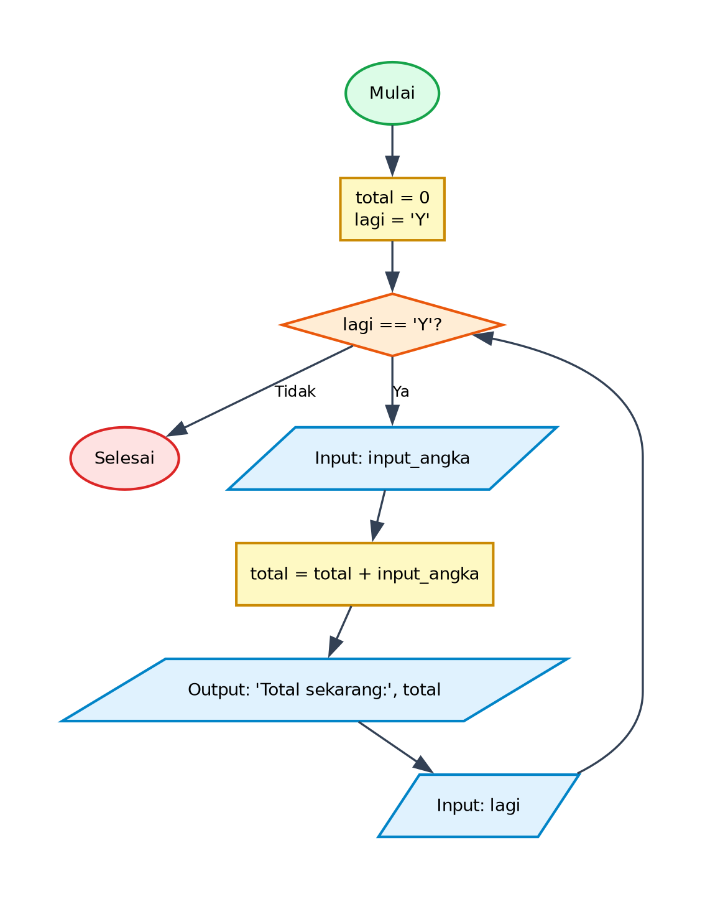

# Algoritma dan Pseudocode - Program Menghitung Total Angka

## 1. Deskripsi Program
Program ini mengakumulasikan bilangan yang dimasukkan oleh pengguna secara berulang menggunakan perulangan `while`. Program terus meminta input angka dan menambahkan nilainya ke variabel `total` hingga pengguna memilih untuk tidak melanjutkan (`lagi != 'Y'`).

- **File Program**: [`MenghitungTotalAngka.py`](./MenghitungTotalAngka.py)
- **Direktori**: `01-menghitung-total-angka`

---

## 2. Analisis Masalah
- **Input**:
  - `total` (integer): Menyimpan nilai akumulasi dari seluruh angka yang diinputkan (diinisialisasi 0)
- **Proses**:
  - Validasi kondisi perulangan dan percabangan logika sesuai spesifikasi program.
  - Perhitungan matematika / manipulasi data / akumulasi nilai.
- **Output**:
  - Menampilkan hasil pengolahan, status operasi, rincian iterasi, atau representasi visual.

---

## 3. Kamus Data / Deklarasi Variabel
| Nama Variabel | Tipe Data | Keterangan |
| :--- | :--- | :--- |
| `total` | integer | Menyimpan nilai akumulasi dari seluruh angka yang diinputkan (diinisialisasi 0) |
| `lagi` | string | Menyimpan status keputusan pengguna untuk mengulang atau berhenti ('Y' / 'T') |
| `input_angka` | integer | Menyimpan angka yang dimasukkan pengguna pada setiap iterasi |

---

## 4. Algoritma (Pseudocode)

```pseudocode
ALGORITMA MenghitungTotalAngka
DEKLARASI:
    total : integer
    lagi : string
    input_angka : integer

DESKRIPSI:
    total <- 0
    lagi <- "Y"
    
    WHILE lagi == "Y" DO
        OUTPUT "Masukkan angka: "
        INPUT input_angka
        
        total <- total + input_angka
        OUTPUT "Total sekarang: ", total
        
        OUTPUT "Lagi? "
        INPUT lagi
    ENDWHILE
    
    SELESAI
```

---

## 5. Flowchart

Berikut adalah diagram alir (*flowchart*) dari algoritma di atas:



> File diagram tersedia dalam format **PNG** ([`flowchart.png`](./flowchart.png)) dan **JPG** ([`flowchart.jpg`](./flowchart.jpg)).

---

## 6. Penjelasan Alur Eksekusi (Traceability)
1. Program dimulai (Start).
2. Inisialisasi variabel `total = 0` dan flag pengulangan `lagi = 'Y'`.
3. Kondisi perulangan diperiksa: apakah `lagi == 'Y'`?
4. Jika Ya: pengguna memasukkan `input_angka`, kemudian nilai ditambahkan ke `total` (`total = total + input_angka`), nilai total terbaru dicetak, dan pengguna ditanya konfirmasi `lagi?`.
5. Alur kembali memeriksa kondisi `lagi == 'Y'`.
6. Jika Tidak: perulangan berakhir dan program selesai (End).
