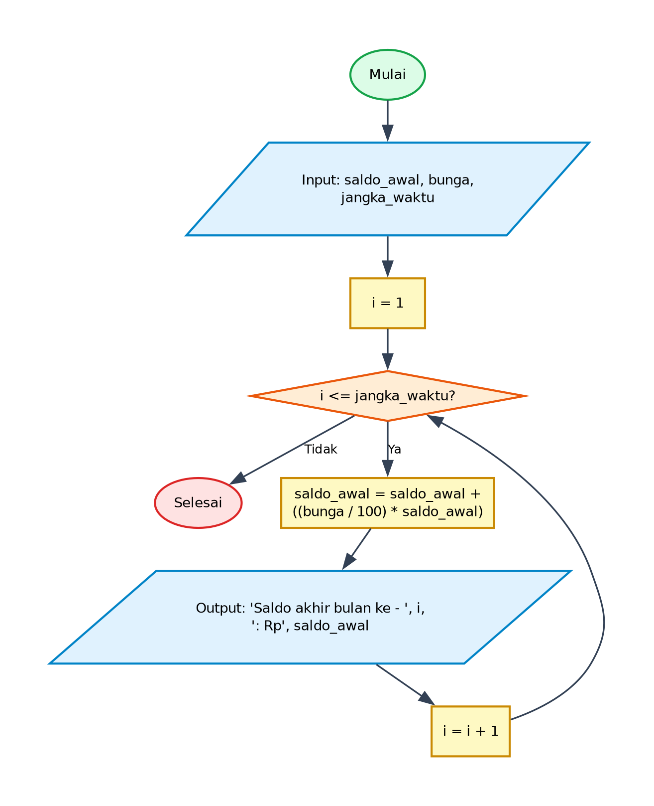

# Algoritma dan Pseudocode - Program Menghitung Rincian Saldo Tabungan

## 1. Deskripsi Program
Program ini menghitung akumulasi saldo tabungan dengan bunga berbunga (compound interest) per bulan untuk periode waktu tertentu menggunakan perulangan terhitung `for`. Setiap iterasi merepresentasikan satu bulan dan mencetak saldo akhir bulan tersebut.

- **File Program**: [`MenghitungRincianSaldo.py`](./MenghitungRincianSaldo.py)
- **Direktori**: `02-menghitung-rincian-saldo`

---

## 2. Analisis Masalah
- **Input**:
  - Menggunakan nilai awal/parameter yang didefinisikan dalam kode.
- **Proses**:
  - Validasi kondisi perulangan dan percabangan logika sesuai spesifikasi program.
  - Perhitungan matematika / manipulasi data / akumulasi nilai.
- **Output**:
  - Menampilkan hasil pengolahan, status operasi, rincian iterasi, atau representasi visual.

---

## 3. Kamus Data / Deklarasi Variabel
| Nama Variabel | Tipe Data | Keterangan |
| :--- | :--- | :--- |
| `saldo_awal` | float | Menyimpan nilai saldo awal dan saldo terupdate setiap bulan |
| `bunga` | integer | Persentase suku bunga per bulan |
| `jangka_waktu` | integer | Jumlah bulan penyimpanan tabungan |
| `i` | integer | Variabel pencacah (counter) perulangan bulan (1 sampai jangka_waktu) |

---

## 4. Algoritma (Pseudocode)

```pseudocode
ALGORITMA MenghitungRincianSaldo
DEKLARASI:
    saldo_awal : float
    bunga : integer
    jangka_waktu : integer
    i : integer

DESKRIPSI:
    OUTPUT "Masukkan saldo awal: "
    INPUT saldo_awal
    OUTPUT "Masukkan jumlah bunga: "
    INPUT bunga
    OUTPUT "Masukkan jangka waktu: "
    INPUT jangka_waktu

    FOR i <- 1 TO jangka_waktu DO
        saldo_awal <- saldo_awal + ((bunga / 100) * saldo_awal)
        OUTPUT "Saldo akhir bulan ke - ", i, ": Rp", FORMAT(saldo_awal)
    ENDFOR

    SELESAI
```

---

## 5. Flowchart

Berikut adalah diagram alir (*flowchart*) dari algoritma di atas:



> File diagram tersedia dalam format **PNG** ([`flowchart.png`](./flowchart.png)) dan **JPG** ([`flowchart.jpg`](./flowchart.jpg)).

---

## 6. Penjelasan Alur Eksekusi (Traceability)
1. Program dimulai (Start).
2. Menerima masukan dari pengguna untuk `saldo_awal`, `bunga` (persen), dan `jangka_waktu` (bulan).
3. Inisialisasi pencacah loop `i = 1`.
4. Mengecek kondisi apakah `i <= jangka_waktu`.
5. Jika Ya: menghitung penambahan saldo `saldo_awal = saldo_awal + ((bunga / 100) * saldo_awal)`, mencetak saldo akhir bulan ke-`i`, menambahkan `i = i + 1`, dan kembali ke pengecekan kondisi loop.
6. Jika Tidak: loop selesai dan program berakhir (End).
