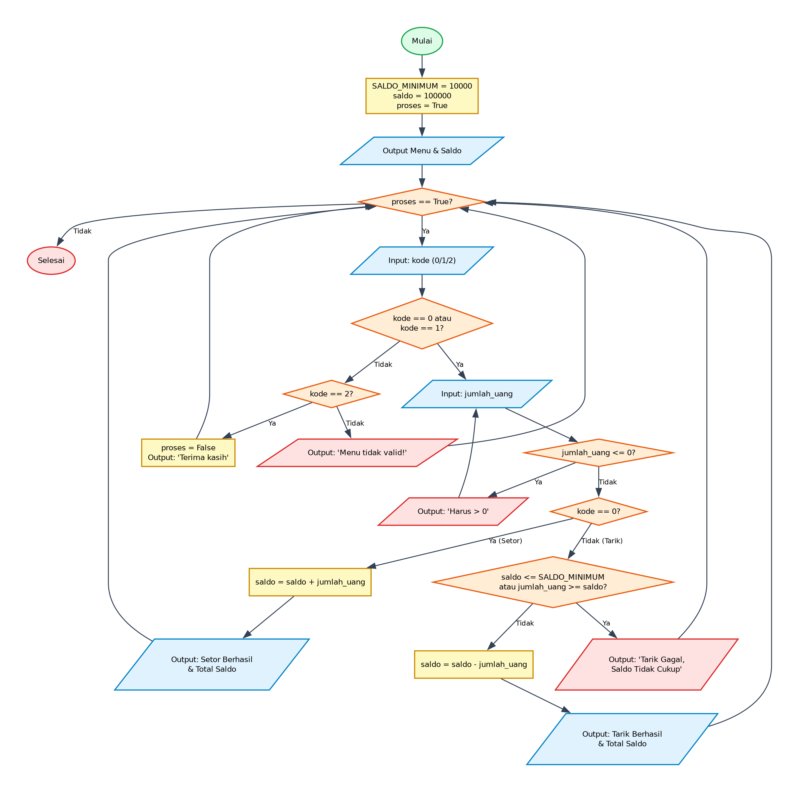

# Algoritma dan Pseudocode - Program Simulasi Setor dan Tarik Tunai

## 1. Deskripsi Program
Program ini mensimulasikan operasional mesin ATM sederhana untuk transaksi setor dan tarik tunai. Menggunakan perulangan bersyarat `while proses` yang menyajikan menu interaktif, validasi jumlah transaksi harus positif (> 0), validasi kecukupan saldo dan saldo minimum saat penarikan tunai.

- **File Program**: [`SetorDanTarikTunai.py`](./SetorDanTarikTunai.py)
- **Direktori**: `03-setor-dan-tarik-tunai`

---

## 2. Analisis Masalah
- **Input**:
  - `kode` (integer): Pilihan menu (0: Setor, 1: Tarik, 2: Keluar)
- **Proses**:
  - Validasi kondisi perulangan dan percabangan logika sesuai spesifikasi program.
  - Perhitungan matematika / manipulasi data / akumulasi nilai.
- **Output**:
  - Menampilkan hasil pengolahan, status operasi, rincian iterasi, atau representasi visual.

---

## 3. Kamus Data / Deklarasi Variabel
| Nama Variabel | Tipe Data | Keterangan |
| :--- | :--- | :--- |
| `SALDO_MINIMUM` | float / konstan | Batas minimum saldo yang harus tersisa (Rp10.000) |
| `saldo` | float | Menyimpan nilai saldo rekening pengguna (saldo awal Rp100.000) |
| `proses` | boolean | Flag pengontrol perulangan program utama |
| `kode` | integer | Pilihan menu (0: Setor, 1: Tarik, 2: Keluar) |
| `jumlah_uang` | float | Nominal uang yang disetor atau ditarik |

---

## 4. Algoritma (Pseudocode)

```pseudocode
ALGORITMA SetorDanTarikTunai
DEKLARASI:
    SALDO_MINIMUM : float (konstanta = 10000)
    saldo : float
    proses : boolean
    kode : integer
    jumlah_uang : float

DESKRIPSI:
    OUTPUT "Menu: 0. Setor tunai, 1. Tarik tunai, 2. Keluar"
    SALDO_MINIMUM <- 10000
    saldo <- 100000
    proses <- TRUE
    OUTPUT "Saldo saat ini: Rp", saldo

    WHILE proses == TRUE DO
        OUTPUT "Pilih menu (0 / 1 / 2): "
        INPUT kode

        IF kode >= 0 AND kode <= 1 THEN
            OUTPUT "Masukkan jumlah uang: "
            INPUT jumlah_uang

            WHILE jumlah_uang <= 0 DO
                OUTPUT "Setor / tarik tunai harus lebih dari 0 rupiah"
                OUTPUT "Masukkan jumlah uang: "
                INPUT jumlah_uang
            ENDWHILE

            IF kode == 0 THEN
                saldo <- saldo + jumlah_uang
                OUTPUT "Setor tunai sebesar Rp", jumlah_uang, " berhasil dilakukan."
                OUTPUT "Total saldo: Rp", saldo
            ELSE IF kode == 1 THEN
                IF saldo <= SALDO_MINIMUM OR jumlah_uang >= saldo THEN
                    OUTPUT "Tarik tunai gagal dilakukan. Saldo tidak mencukupi!"
                ELSE
                    saldo <- saldo - jumlah_uang
                    OUTPUT "Tarik tunai sebesar Rp", jumlah_uang, " berhasil dilakukan."
                    OUTPUT "Total saldo: Rp", saldo
                ENDIF
            ENDIF
        ELSE IF kode == 2 THEN
            proses <- FALSE
            OUTPUT "Terima kasih"
        ELSE
            OUTPUT "Menu tidak valid!"
        ENDIF
    ENDWHILE

    SELESAI
```

---

## 5. Flowchart

Berikut adalah diagram alir (*flowchart*) dari algoritma di atas:



> File diagram tersedia dalam format **PNG** ([`flowchart.png`](./flowchart.png)) dan **JPG** ([`flowchart.jpg`](./flowchart.jpg)).

---

## 6. Penjelasan Alur Eksekusi (Traceability)
1. Program dimulai (Start), inisialisasi `SALDO_MINIMUM = 10000`, `saldo = 100000`, `proses = True` dan tampilkan menu beserta saldo awal.
2. Loop `while proses` berjalan, menerima masukan `kode` menu dari user.
3. Jika `kode` bernilai 0 atau 1: pengguna diminta memasukkan `jumlah_uang`. Jika `jumlah_uang <= 0`, dilakukan loop validasi hingga input > 0.
4. Jika `kode == 0` (Setor Tunai): saldo ditambah sejumlah uang, lalu konfirmasi dan total saldo ditampilkan.
5. Jika `kode == 1` (Tarik Tunai): sistem memeriksa apakah saldo mencukupi (`saldo <= SALDO_MINIMUM or jumlah_uang >= saldo`). Jika ya, transaksi dibatalkan; jika tidak, saldo dikurangi dan struk saldo dicetak.
6. Jika `kode == 2` (Keluar): nilai `proses` diubah menjadi `False`, pesan penutup dicetak, dan loop berhenti.
7. Jika `kode` di luar opsi (0, 1, 2): dicetak 'Menu tidak valid!' dan kembali ke menu utama.
8. Program selesai (End).
