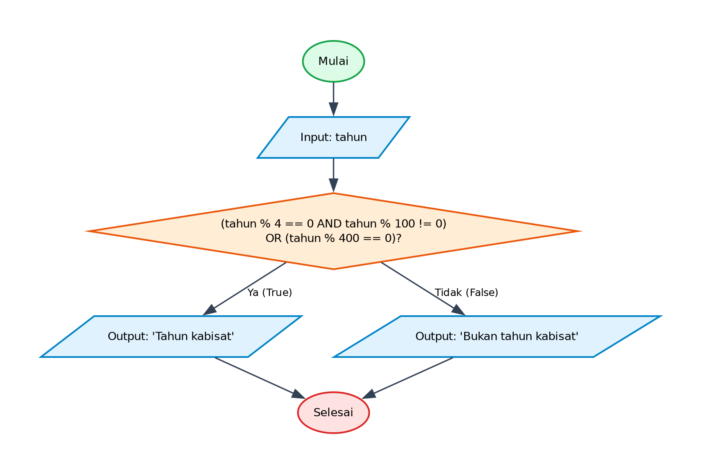

# Algoritma dan Pseudocode - Program Menentukan Tahun Kabisat

## 1. Deskripsi Program
Program ini menentukan apakah sebuah tahun merupakan tahun kabisat (leap year) atau bukan berdasarkan aturan kalender Gregorian: tahun habis dibagi 4 namun tidak habis dibagi 100, atau tahun habis dibagi 400.

- **File Program**: [`MenentukanTahunKabisat.py`](./MenentukanTahunKabisat.py)
- **Direktori**: `04-menentukan-tahun-kabisat`

---

## 2. Analisis Masalah
- **Input**:
  - `tahun` (integer): Tahun yang diinputkan pengguna untuk diperiksa
- **Proses**:
  - Validasi kondisi perulangan dan percabangan logika sesuai spesifikasi program.
  - Perhitungan matematika / manipulasi data / akumulasi nilai.
- **Output**:
  - Menampilkan hasil pengolahan, status operasi, rincian iterasi, atau representasi visual.

---

## 3. Kamus Data / Deklarasi Variabel
| Nama Variabel | Tipe Data | Keterangan |
| :--- | :--- | :--- |
| `tahun` | integer | Tahun yang diinputkan pengguna untuk diperiksa |

---

## 4. Algoritma (Pseudocode)

```pseudocode
ALGORITMA MenentukanTahunKabisat
DEKLARASI:
    tahun : integer

DESKRIPSI:
    OUTPUT "Masukkan tahun: "
    INPUT tahun

    IF (tahun MOD 4 == 0 AND tahun MOD 100 != 0) OR (tahun MOD 400 == 0) THEN
        OUTPUT "Tahun kabisat"
    ELSE
        OUTPUT "Bukan tahun kabisat"
    ENDIF

    SELESAI
```

---

## 5. Flowchart

Berikut adalah diagram alir (*flowchart*) dari algoritma di atas:



> File diagram tersedia dalam format **PNG** ([`flowchart.png`](./flowchart.png)) dan **JPG** ([`flowchart.jpg`](./flowchart.jpg)).

---

## 6. Penjelasan Alur Eksekusi (Traceability)
1. Program dimulai (Start).
2. Menerima masukan variabel `tahun` dari pengguna.
3. Mengevaluasi ekspresi logika kabisat: `(tahun % 4 == 0 and tahun % 100 != 0) or (tahun % 400 == 0)`.
4. Jika kondisi bernilai Benar (True): mencetak 'Tahun kabisat'.
5. Jika kondisi bernilai Salah (False): mencetak 'Bukan tahun kabisat'.
6. Program selesai (End).
