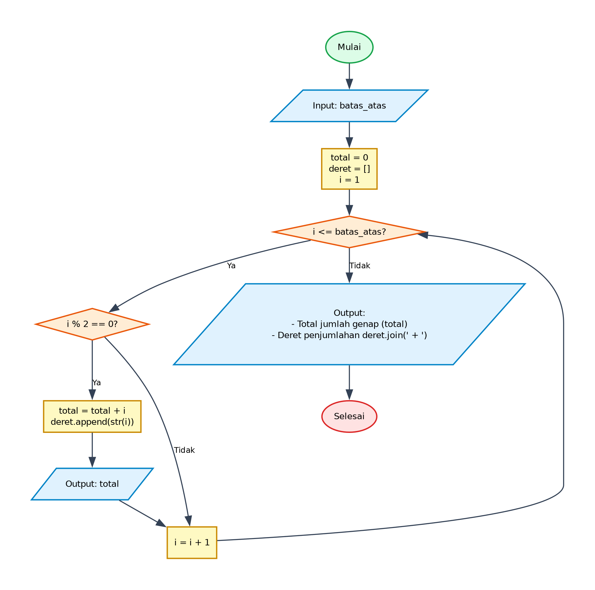

# Algoritma dan Pseudocode - Program Penjumlahan Bilangan Genap

## 1. Deskripsi Program
Program ini meminta pengguna memasukkan sebuah bilangan bulat sebagai batas atas rentang pencarian (`batas_atas`). Selanjutnya, program mencari dan menjumlahkan semua bilangan bulat genap dari 1 hingga `batas_atas` menggunakan perulangan `for` dan seleksi kondisi modulo `i % 2 == 0`. Setiap menemukan bilangan genap, program mengupdate total akumulasi, menyimpannya ke dalam list deret, dan mencetak total berjalan (*running sum*). Di akhir proses, program menampilkan total keseluruhan dan format deret penjumlahannya.

- **File Program**: [`JumlahBilanganGenap.py`](./JumlahBilanganGenap.py)
- **Direktori**: `05-jumlah-bilangan-genap`

---

## 2. Analisis Masalah
- **Input**:
  - `batas_atas` (integer): Nilai batas atas yang dimasukkan oleh pengguna melalui input konsol.
- **Proses**:
  - Inisialisasi variabel akumulator `total = 0` dan list penampung `deret = []`.
  - Melakukan iterasi dari `i = 1` hingga `i = batas_atas`.
  - Pengecekan kondisi genap: `i % 2 == 0`.
  - Jika genap:
    - Tambahkan nilai `i` ke `total` (`total = total + i`).
    - Simpan representasi string dari `i` ke list `deret`.
    - Cetak nilai `total` berjalan.
  - Increment pencacah `i`.
  - Setelah perulangan selesai, gabungkan elemen-elemen `deret` dengan pemisah `" + "`.
- **Output**:
  - Nilai subtotal pada setiap bilangan genap yang ditemukan.
  - Teks total jumlah bilangan genap dari 1 sampai `batas_atas`.
  - Representasi deret penjumlahan (contoh: `2 + 4 + 6 + 8 + 10`).

---

## 3. Kamus Data / Deklarasi Variabel
| Nama Variabel | Tipe Data | Keterangan |
| :--- | :--- | :--- |
| `batas_atas` | integer | Nilai batas atas rentang bilangan bulat yang diinput pengguna |
| `total` | integer | Menyimpan nilai akumulasi penjumlahan bilangan genap (diinisialisasi 0) |
| `deret` | array of string / list | Menyimpan representasi teks bilangan genap untuk ditampilkan sebagai deret |
| `i` | integer | Variabel pencacah (counter) perulangan (dari 1 hingga batas_atas) |

---

## 4. Algoritma (Pseudocode)

```pseudocode
ALGORITMA JumlahBilanganGenap
DEKLARASI:
    batas_atas : integer
    total : integer
    deret : array of string
    i : integer

DESKRIPSI:
    OUTPUT "Masukkan batas atas: "
    INPUT batas_atas

    total <- 0
    deret <- []

    FOR i <- 1 TO batas_atas DO
        IF i MOD 2 == 0 THEN
            total <- total + i
            APPEND STRING(i) TO deret
            OUTPUT total
        ENDIF
    ENDFOR

    OUTPUT "Total jumlah bilangan genap dari 1 sampai ", batas_atas, " adalah ", total
    OUTPUT JOIN(deret, " + ")

    SELESAI
```

---

## 5. Flowchart

Berikut adalah diagram alir (*flowchart*) dari algoritma di atas:



> File diagram tersedia dalam format **PNG** ([`flowchart.png`](./flowchart.png)) dan **JPG** ([`flowchart.jpg`](./flowchart.jpg)).

---

## 6. Penjelasan Alur Eksekusi (Traceability)
1. **Mulai (Start)**: Eksekusi program dimulai.
2. **Input `batas_atas`**: Pengguna diminta memasukkan nilai batas atas bilangan bulat.
3. **Inisialisasi**: Mengeset `total = 0`, mengosongkan list `deret = []`, dan mengatur nilai awal pencacah `i = 1`.
4. **Pemeriksaan Kondisi Perulangan (`i <= batas_atas`)**:
   - Jika `i <= batas_atas` bernilai **Ya (True)**:
     - Evaluasi apakah `i` habis dibagi 2 (`i % 2 == 0`).
     - **Jika Ya (Genap)**:
       - Tambahkan `i` ke `total` (`total = total + i`).
       - Tambahkan `str(i)` ke list `deret`.
       - Cetak nilai `total` saat ini ke layar.
       - Tambahkan `i = i + 1`.
     - **Jika Tidak (Ganjil)**:
       - Langsung tambahkan `i = i + 1` tanpa mengubah `total` maupun `deret`.
     - Kembali ke langkah 4 untuk iterasi berikutnya.
   - Jika `i <= batas_atas` bernilai **Tidak (False)** (perulangan selesai):
     - Lanjut ke langkah 5.
5. **Output Akhir**:
   - Tampilkan kalimat ringkasan total: `"Total jumlah bilangan genap dari 1 sampai {batas_atas} adalah {total}"`.
   - Tampilkan deret angka genap yang digabungkan dengan tanda plus: `"{" + ".join(deret)}"`.
6. **Selesai (End)**: Program berakhir.
