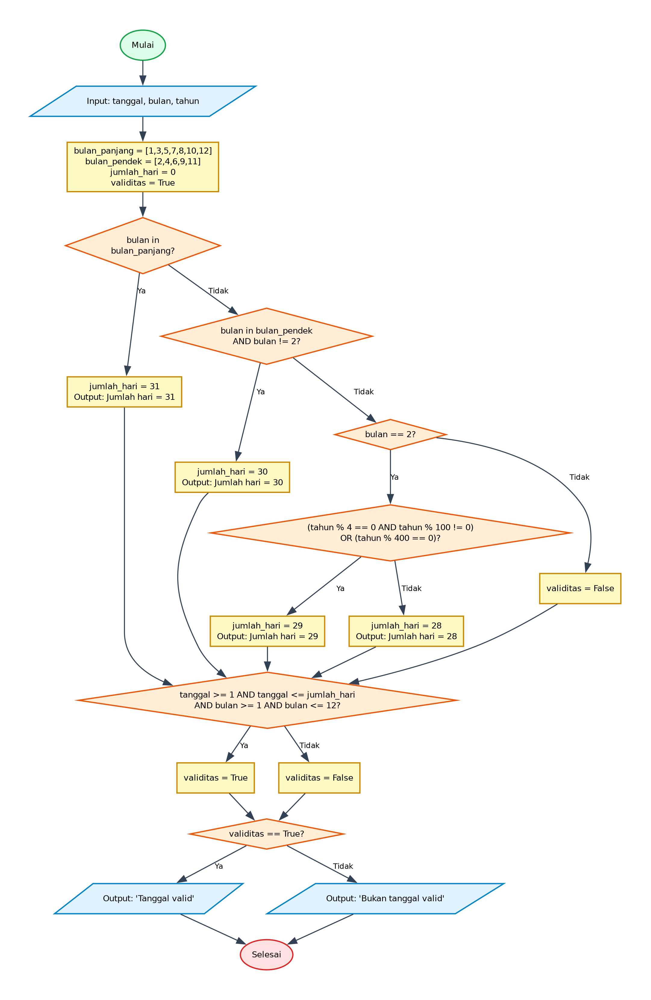

# Algoritma dan Pseudocode - Program Validasi Tanggal Kalender

## 1. Deskripsi Program
Program ini meminta pengguna memasukkan tanggal, bulan, dan tahun secara interaktif, kemudian memvalidasi keabsahan kombinasi tanggal tersebut. Program menentukan batas hari maksimum untuk bulan yang diinputkan (31 hari untuk bulan panjang, 30 hari untuk bulan pendek, serta 28 atau 29 hari untuk bulan Februari tergantung status tahun kabisat). Setelah batas hari ditentukan, program mengecek apakah nilai tanggal dan bulan berada di dalam rentang yang valid dan menampilkan status validitasnya.

- **File Program**: [`ValidasiTanggal.py`](./ValidasiTanggal.py)
- **Direktori**: `06-validasi-tanggal`

---

## 2. Analisis Masalah
- **Input**:
  - `tanggal` (integer): Nilai hari/tanggal yang dimasukkan oleh pengguna via input konsol.
  - `bulan` (integer): Nilai bulan (1 - 12) yang dimasukkan oleh pengguna via input konsol.
  - `tahun` (integer): Nilai tahun yang dimasukkan oleh pengguna via input konsol.
- **Proses**:
  - Inisialisasi daftar bulan panjang `[1, 3, 5, 7, 8, 10, 12]`, bulan pendek `[2, 4, 6, 9, 11]`, `jumlah_hari = 0`, dan flag awal `validitas = True`.
  - Penentuan batas hari (`jumlah_hari`):
    - Jika `bulan in bulan_panjang`: `jumlah_hari = 31`.
    - Jika `bulan in bulan_pendek` dan `bulan != 2`: `jumlah_hari = 30`.
    - Jika `bulan == 2`: Cek aturan tahun kabisat `(tahun % 4 == 0 and tahun % 100 != 0) or (tahun % 400 == 0)`. Jika kabisat maka `jumlah_hari = 29`, jika bukan kabisat maka `jumlah_hari = 28`.
    - Jika bulan di luar rentang valid: `validitas = False`.
  - Pengecekan keabsahan rentang:
    - Memeriksa apakah `tanggal >= 1 and tanggal <= jumlah_hari` dan `bulan >= 1 and bulan <= 12`.
    - Jika memenuhi maka `validitas = True`, jika tidak maka `validitas = False`.
- **Output**:
  - Informasi `jumlah_hari` per bulan jika bulan valid.
  - Teks status apakah tanggal valid atau bukan tanggal valid (`Tanggal dd/mm/yyyy adalah tanggal valid` atau `bukan tanggal valid`).

---

## 3. Kamus Data / Deklarasi Variabel
| Nama Variabel | Tipe Data | Keterangan |
| :--- | :--- | :--- |
| `tanggal` | integer | Nilai tanggal/hari yang diinputkan pengguna |
| `bulan` | integer | Nilai bulan (1 - 12) yang diinputkan pengguna |
| `tahun` | integer | Nilai tahun yang diinputkan pengguna |
| `bulan_panjang` | array of integer / list | Daftar bulan yang memiliki 31 hari `[1, 3, 5, 7, 8, 10, 12]` |
| `bulan_pendek` | array of integer / list | Daftar bulan yang memiliki 30 hari atau Februari `[2, 4, 6, 9, 11]` |
| `jumlah_hari` | integer | Batas jumlah hari maksimum pada bulan bersangkutan |
| `validitas` | boolean | Status keabsahan tanggal (`True` jika valid, `False` jika tidak valid) |

---

## 4. Algoritma (Pseudocode)

```pseudocode
ALGORITMA ValidasiTanggal
DEKLARASI:
    tanggal, bulan, tahun : integer
    bulan_panjang, bulan_pendek : array of integer
    jumlah_hari : integer
    validitas : boolean

DESKRIPSI:
    OUTPUT "Masukkan tanggal: "
    INPUT tanggal
    OUTPUT "Masukkan bulan: "
    INPUT bulan
    OUTPUT "Masukkan tahun: "
    INPUT tahun

    bulan_panjang <- [1, 3, 5, 7, 8, 10, 12]
    bulan_pendek <- [2, 4, 6, 9, 11]
    jumlah_hari <- 0
    validitas <- TRUE

    IF bulan IN bulan_panjang THEN
        jumlah_hari <- 31
        OUTPUT "Jumlah hari = ", jumlah_hari
    ELSE IF bulan IN bulan_pendek AND bulan != 2 THEN
        jumlah_hari <- 30
        OUTPUT "Jumlah hari = ", jumlah_hari
    ELSE IF bulan == 2 THEN
        IF (tahun MOD 4 == 0 AND tahun MOD 100 != 0) OR (tahun MOD 400 == 0) THEN
            jumlah_hari <- 29
            OUTPUT "Jumlah hari = ", jumlah_hari
        ELSE
            jumlah_hari <- 28
            OUTPUT "Jumlah hari = ", jumlah_hari
        ENDIF
    ELSE
        validitas <- FALSE
    ENDIF

    IF (tanggal >= 1 AND tanggal <= jumlah_hari) AND (bulan >= 1 AND bulan <= 12) THEN
        validitas <- TRUE
    ELSE
        validitas <- FALSE
    ENDIF

    IF validitas == TRUE THEN
        OUTPUT "Tanggal ", tanggal, "/", bulan, "/", tahun, " adalah tanggal valid"
    ELSE
        OUTPUT "Tanggal ", tanggal, "/", bulan, "/", tahun, " adalah bukan tanggal valid"
    ENDIF

    SELESAI
```

---

## 5. Flowchart

Berikut adalah diagram alir (*flowchart*) dari algoritma di atas:



> File diagram tersedia dalam format **PNG** ([`flowchart.png`](./flowchart.png)) dan **JPG** ([`flowchart.jpg`](./flowchart.jpg)).

---

## 6. Penjelasan Alur Eksekusi (Traceability)
1. **Mulai (Start)**: Program dimulai.
2. **Input Pengguna**: Pengguna memasukkan nilai `tanggal`, `bulan`, dan `tahun`.
3. **Inisialisasi Variabel**: Mengeset daftar `bulan_panjang`, `bulan_pendek`, nilai `jumlah_hari = 0`, serta status default `validitas = True`.
4. **Penentuan Jumlah Hari Berdasarkan Bulan**:
   - Jika `bulan` termasuk dalam `bulan_panjang`, set `jumlah_hari = 31` dan tampilkan nilai tersebut.
   - Jika `bulan` termasuk dalam `bulan_pendek` dan `bulan != 2`, set `jumlah_hari = 30` dan tampilkan.
   - Jika `bulan == 2`, lakukan pengecekan tahun kabisat:
     - Jika `(tahun % 4 == 0 and tahun % 100 != 0) or (tahun % 400 == 0)` bernilai Benar, set `jumlah_hari = 29`.
     - Jika bernilai Salah, set `jumlah_hari = 28`.
     - Tampilkan nilai `jumlah_hari`.
   - Jika bulan tidak memenuhi kriteria di atas (misal `< 1` atau `> 12`), set `validitas = False`.
5. **Evaluasi Validitas Tanggal**:
   - Mengecek ekspresi: `(tanggal >= 1 and tanggal <= jumlah_hari) and (bulan >= 1 and bulan <= 12)`.
   - Jika Benar, set `validitas = True`.
   - Jika Salah, set `validitas = False`.
6. **Penampilan Hasil**:
   - Jika `validitas == True`, cetak `"Tanggal dd/mm/yyyy adalah tanggal valid"`.
   - Jika `validitas == False`, cetak `"Tanggal dd/mm/yyyy adalah bukan tanggal valid"`.
7. **Selesai (End)**: Eksekusi selesai.
