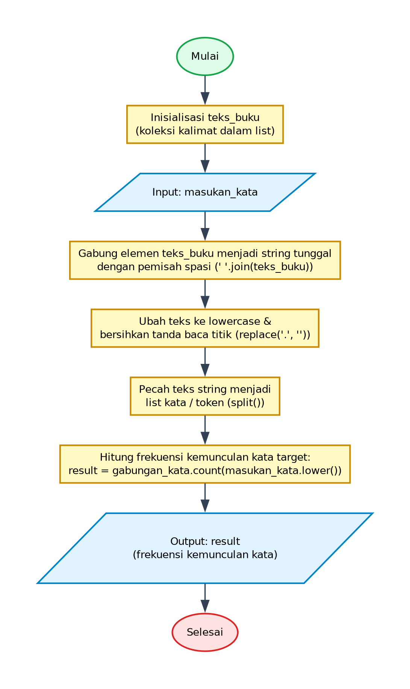

# Algoritma dan Pseudocode - Program Mencari Frekuensi Kata dalam Teks

## 1. Deskripsi Program
Program ini melakukan pencarian teks (*string searching / text mining dasar*) untuk menghitung berapa kali sebuah kata target yang dimasukkan oleh pengguna (`masukan_kata`) muncul di dalam kumpulan kalimat dokumen (`teks_buku`). Program melakukan tahapan pra-pemrosesan teks (*text preprocessing*) meliputi penggabungan seluruh kalimat, konversi teks menjadi huruf kecil (*case-insensitive*), pembersihan tanda baca titik, pemecahan menjadi daftar token kata, dan penghitungan frekuensi kata secara akurat.

- **File Program**: [`MencariKata.py`](./MencariKata.py)
- **Direktori**: `07-mencari-kata`

---

## 2. Analisis Masalah
- **Input**:
  - `masukan_kata` (string): Kata kunci yang dimasukkan oleh pengguna melalui konsol untuk dihitung frekuensinya.
- **Proses**:
  - Inisialisasi kumpulan kalimat teks dalam list `teks_buku`.
  - Menerima masukan kata dari pengguna via `input("Masukkan kata: ")`.
  - Penggabungan teks: Menggabungkan seluruh baris kalimat menjadi satu string panjang dengan spasi sebagai pemisah (`" ".join(teks_buku)`).
  - Normalisasi teks: Mengubah seluruh karakter ke huruf kecil (`lower()`).
  - Pembersihan teks (*cleaning*): Menghapus tanda baca titik (`replace(".", "")`).
  - Tokenisasi: Memisahkan teks string menjadi list kata berdasarkan spasi (`split()`).
  - Penghitungan frekuensi: Menghitung kemunculan kata pencarian dengan metode `.count(masukan_kata.lower())`.
- **Output**:
  - `result` (integer): Angka yang menyatakan berapa kali kata kunci ditemukan dalam teks.

---

## 3. Kamus Data / Deklarasi Variabel
| Nama Variabel | Tipe Data | Keterangan |
| :--- | :--- | :--- |
| `teks_buku` | array of string / list | Koleksi kalimat-kalimat dokumen teks sumber |
| `masukan_kata` | string | Kata kunci pencarian yang dimasukkan secara dinamis oleh pengguna |
| `gabungan_string` | string | Variabel perantara hasil penggabungan dan pembersihan teks |
| `gabungan_kata` | array of string / list | Daftar token kata hasil pemisahan (*split*) teks bersih |
| `result` | integer | Jumlah frekuensi kemunculan kata kunci yang dicari |

---

## 4. Algoritma (Pseudocode)

```pseudocode
ALGORITMA MencariKata
DEKLARASI:
    teks_buku : array of string
    masukan_kata : string
    gabungan_string : string
    gabungan_kata : array of string
    result : integer

DESKRIPSI:
    teks_buku <- [
        "Python adalah bahasa pemrograman yang sangat populer.",
        "Banyak orang menggunakan Python untuk data science.",
        "Python juga digunakan untuk pengembangan web dan otomatisasi.",
        "Pemrograman dengan Python memungkinkan pembuatan aplikasi dengan cepat."
    ]

    OUTPUT "Masukkan kata: "
    INPUT masukan_kata

    gabungan_string <- JOIN(teks_buku, " ")
    gabungan_string <- TO_LOWER(gabungan_string)
    gabungan_string <- REPLACE(gabungan_string, ".", "")
    gabungan_kata <- SPLIT(gabungan_string, " ")

    result <- COUNT(gabungan_kata, TO_LOWER(masukan_kata))
    OUTPUT result

    SELESAI
```

---

## 5. Flowchart

Berikut adalah diagram alir (*flowchart*) dari algoritma di atas:



> File diagram tersedia dalam format **PNG** ([`flowchart.png`](./flowchart.png)) dan **JPG** ([`flowchart.jpg`](./flowchart.jpg)).

---

## 6. Penjelasan Alur Eksekusi (Traceability)
1. **Mulai (Start)**: Program dimulai.
2. **Inisialisasi `teks_buku`**: Program menyiapkan sekumpulan kalimat dalam bentuk array/list string `teks_buku`.
3. **Input `masukan_kata`**: Menampilkan pesan `"Masukkan kata: "` dan membaca string kata yang dicari dari pengguna.
4. **Penggabungan Teks (Join)**: Seluruh string dalam `teks_buku` disatukan menjadi satu kalimat panjang dipisahkan spasi.
5. **Pembersihan & Normalisasi Teks**:
   - Menyeragamkan seluruh huruf menjadi huruf kecil (*case folding*) dengan fungsi `lower()`.
   - Menghapus tanda titik `.` dengan `replace(".", "")` agar kata di akhir kalimat tidak terbaca bersama tanda titik.
6. **Tokenisasi (Split)**: Kalimat panjang dipecah menjadi array kumpulan kata individual (`gabungan_kata`).
7. **Perhitungan Frekuensi (Count)**: Menghitung berapa kali kata target (yang juga dikonversi ke lowercase) muncul dalam array kata, dan hasilnya disimpan dalam variabel `result`.
8. **Output**: Menampilkan nilai `result` ke layar.
9. **Selesai (End)**: Program berakhir.
