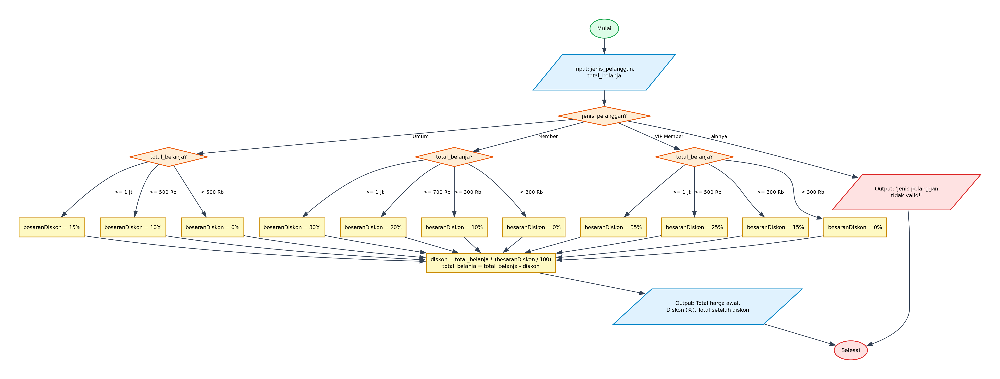

# Algoritma dan Pseudocode - Program Menghitung Total Belanja Berdasarkan Tipe Pelanggan

## 1. Deskripsi Program
Program ini menghitung total belanja akhir setelah dipotong diskon bertingkat yang bergantung pada jenis pelanggan (Umum, Member, VIP Member) dan rentang total belanja yang dicapai. Menggunakan struktur seleksi bertingkat (nested IF-ELIF-ELSE).

- **File Program**: [`MenghitungTotalHargaByTipePelanggan.py`](./MenghitungTotalHargaByTipePelanggan.py)
- **Direktori**: `08-menghitung-total-harga-by-tipe-pelanggan`

---

## 2. Analisis Masalah
- **Input**:
  - Menggunakan nilai awal/parameter yang didefinisikan dalam kode.
- **Proses**:
  - Validasi kondisi perulangan dan percabangan logika sesuai spesifikasi program.
  - Perhitungan matematika / manipulasi data / akumulasi nilai.
- **Output**:
  - Menampilkan hasil pengolahan, status operasi, rincian iterasi, atau representasi visual.

---

## 3. Kamus Data / Deklarasi Variabel
| Nama Variabel | Tipe Data | Keterangan |
| :--- | :--- | :--- |
| `jenis_pelanggan` | string | Status keanggotaan pelanggan ('Umum', 'Member', atau 'VIP Member') |
| `total_belanja` | float | Total belanja kotor (awal) dan total belanja bersih (setelah diskon) |
| `besaranDiskon` | integer | Persentase diskon yang berhak diperoleh (0% - 35%) |
| `diskon` | float | Nominal potongan harga hasil perhitungan |

---

## 4. Algoritma (Pseudocode)

```pseudocode
ALGORITMA MenghitungTotalHargaByTipePelanggan
DEKLARASI:
    jenis_pelanggan : string
    total_belanja : float
    besaranDiskon : integer
    diskon : float

DESKRIPSI:
    OUTPUT "Jenis Pelanggan (Umum / Member / VIP Member): "
    INPUT jenis_pelanggan
    OUTPUT "Masukkan total belanja (Rp): "
    INPUT total_belanja

    IF jenis_pelanggan == "Umum" THEN
        IF total_belanja >= 1000000 THEN
            besaranDiskon <- 15
        ELSE IF total_belanja >= 500000 THEN
            besaranDiskon <- 10
        ELSE
            besaranDiskon <- 0
        ENDIF
    ELSE IF jenis_pelanggan == "Member" THEN
        IF total_belanja >= 1000000 THEN
            besaranDiskon <- 30
        ELSE IF total_belanja >= 700000 THEN
            besaranDiskon <- 20
        ELSE IF total_belanja >= 300000 THEN
            besaranDiskon <- 10
        ELSE
            besaranDiskon <- 0
        ENDIF
    ELSE IF jenis_pelanggan == "VIP Member" THEN
        IF total_belanja >= 1000000 THEN
            besaranDiskon <- 35
        ELSE IF total_belanja >= 500000 THEN
            besaranDiskon <- 25
        ELSE IF total_belanja >= 300000 THEN
            besaranDiskon <- 15
        ELSE
            besaranDiskon <- 0
        ENDIF
    ELSE
        OUTPUT "Jenis pelanggan tidak valid!"
        STOP
    ENDIF

    OUTPUT "Total harga awal Rp", total_belanja
    OUTPUT "Diskon sebesar: ", besaranDiskon, "%"

    diskon <- total_belanja * (besaranDiskon / 100)
    total_belanja <- total_belanja - diskon
    OUTPUT "Total setelah diskon Rp", total_belanja

    SELESAI
```

---

## 5. Flowchart

Berikut adalah diagram alir (*flowchart*) dari algoritma di atas:



> File diagram tersedia dalam format **PNG** ([`flowchart.png`](./flowchart.png)) dan **JPG** ([`flowchart.jpg`](./flowchart.jpg)).

---

## 6. Penjelasan Alur Eksekusi (Traceability)
1. Program dimulai (Start), meminta input `jenis_pelanggan` dan `total_belanja`.
2. Pengecekan kategori `jenis_pelanggan`:
3. - Jika 'Umum': belanja >= 1jt dapat diskon 15%, >= 500rb dapat 10%, lainnya 0%.
4. - Jika 'Member': belanja >= 1jt dapat 30%, >= 700rb dapat 20%, >= 300rb dapat 10%, lainnya 0%.
5. - Jika 'VIP Member': belanja >= 1jt dapat 35%, >= 500rb dapat 25%, >= 300rb dapat 15%, lainnya 0%.
6. - Jika tidak cocok: tampilkan 'Jenis pelanggan tidak valid!' dan akhiri program.
7. Hitung nominal diskon: `diskon = total_belanja * (besaranDiskon / 100)`.
8. Hitung total belanja akhir: `total_belanja = total_belanja - diskon`.
9. Cetak rincian total awal, persentase diskon, dan total setelah diskon.
10. Program selesai (End).
