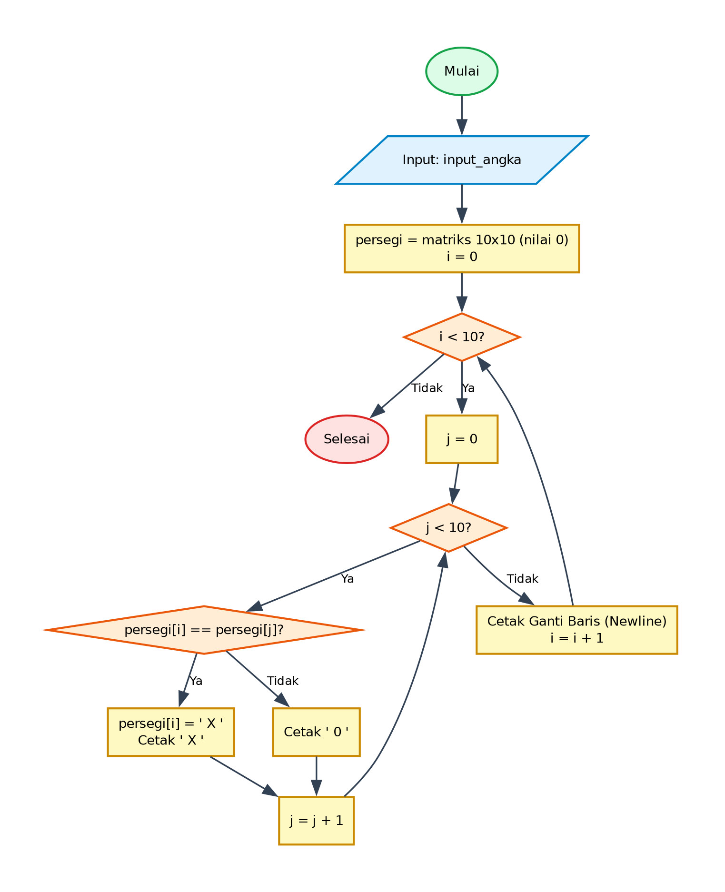

# Algoritma dan Pseudocode - Program Pembuatan Pola Persegi Matriks 2D

## 1. Deskripsi Program
Program ini membentuk dan mencetak representasi visual matriks 2D berukuran 10x10 menggunakan perulangan bersarang (nested loop). Program membandingkan identitas baris matriks dan mencetak simbol 'X' ketika kondisi terpenuhi serta simbol '0' untuk elemen lainnya.

- **File Program**: [`PolaPersegi.py`](./PolaPersegi.py)
- **Direktori**: `09-pola-persegi`

---

## 2. Analisis Masalah
- **Input**:
  - `input_angka` (integer): Input dimensi/parameter dari pengguna
- **Proses**:
  - Validasi kondisi perulangan dan percabangan logika sesuai spesifikasi program.
  - Perhitungan matematika / manipulasi data / akumulasi nilai.
- **Output**:
  - Menampilkan hasil pengolahan, status operasi, rincian iterasi, atau representasi visual.

---

## 3. Kamus Data / Deklarasi Variabel
| Nama Variabel | Tipe Data | Keterangan |
| :--- | :--- | :--- |
| `input_angka` | integer | Input dimensi/parameter dari pengguna |
| `persegi` | 2D array (10x10) | Matriks dua dimensi berukuran 10 baris x 10 kolom |
| `i` | integer | Indeks baris matriks (0 sampai 9) |
| `j` | integer | Indeks kolom matriks (0 sampai 9) |

---

## 4. Algoritma (Pseudocode)

```pseudocode
ALGORITMA PolaPersegi
DEKLARASI:
    input_angka : integer
    persegi : 2D array of string/integer (10x10)
    i, j : integer

DESKRIPSI:
    OUTPUT "Masukkan persegi: "
    INPUT input_angka

    persegi <- inisialisasi matriks 10 x 10 dengan nilai 0

    FOR i <- 0 TO LEN(persegi) - 1 DO
        FOR j <- 0 TO LEN(persegi) - 1 DO
            IF persegi[i] == persegi[j] THEN
                persegi[i] <- " X "
                OUTPUT " X " (tanpa newline)
            ELSE
                OUTPUT " 0 " (tanpa newline)
            ENDIF
        ENDFOR
        OUTPUT ganti_baris
    ENDFOR

    SELESAI
```

---

## 5. Flowchart

Berikut adalah diagram alir (*flowchart*) dari algoritma di atas:



> File diagram tersedia dalam format **PNG** ([`flowchart.png`](./flowchart.png)) dan **JPG** ([`flowchart.jpg`](./flowchart.jpg)).

---

## 6. Penjelasan Alur Eksekusi (Traceability)
1. Program dimulai (Start) dan meminta input `input_angka`.
2. Inisialisasi struktur data matriks 2 dimensi `persegi` berukuran 10x10 dengan elemen awal 0.
3. Loop luar (`i` dari 0 hingga ukuran matriks): merepresentasikan baris.
4. Loop dalam (`j` dari 0 hingga ukuran matriks): merepresentasikan kolom.
5. Kondisi: jika `persegi[i] == persegi[j]`, ubah nilai elemen menjadi `' X '` dan cetak tanpa pindah baris.
6. Jika tidak cocok, cetak `' 0 '` tanpa pindah baris.
7. Setelah loop dalam selesai untuk satu baris penuh, lakukan cetak ganti baris (`print()`).
8. Setelah seluruh baris selesai diproses, program selesai (End).
