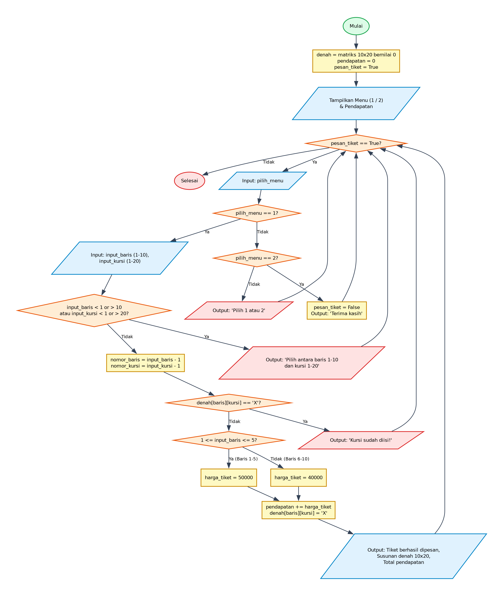

# Algoritma dan Pseudocode - Program Sistem Reservasi Tiket Bioskop

## 1. Deskripsi Program
Program aplikasi sistem penjualan/reservasi tiket bioskop berbasis console. Menggunakan matriks denah 10 baris x 20 kursi. Program menyediakan perulangan menu interaktif, validasi input koordinat kursi, pengecekan ketersediaan kursi, diferensiasi harga tiket berdasarkan baris (baris 1-5 Rp50.000, baris 6-10 Rp40.000), akumulasi pendapatan, serta visualisasi denah kursi terisi ('X') dan kosong ('0').

- **File Program**: [`PenjualanTiket.py`](./PenjualanTiket.py)
- **Direktori**: `10-penjualan-tiket`

---

## 2. Analisis Masalah
- **Input**:
  - `pilih_menu` (integer): Pilihan opsi menu (1: Pesan Tiket, 2: Keluar)
  - `input_baris` (integer): Nomor baris kursi inputan user (1 - 10)
  - `input_kursi` (integer): Nomor kolom kursi inputan user (1 - 20)
  - `nomor_baris` (integer): Indeks baris dalam matriks (input_baris - 1)
  - `nomor_kursi` (integer): Indeks kolom dalam matriks (input_kursi - 1)
- **Proses**:
  - Validasi kondisi perulangan dan percabangan logika sesuai spesifikasi program.
  - Perhitungan matematika / manipulasi data / akumulasi nilai.
- **Output**:
  - Menampilkan hasil pengolahan, status operasi, rincian iterasi, atau representasi visual.

---

## 3. Kamus Data / Deklarasi Variabel
| Nama Variabel | Tipe Data | Keterangan |
| :--- | :--- | :--- |
| `denah` | 2D array (10x20) | Matriks status kursi ('0' = kosong, 'X' = terisi) |
| `pendapatan` | integer | Akumulasi total pendapatan penjualan tiket (Rp) |
| `pesan_tiket` | boolean | Flag pengontrol perulangan menu utama |
| `pilih_menu` | integer | Pilihan opsi menu (1: Pesan Tiket, 2: Keluar) |
| `input_baris` | integer | Nomor baris kursi inputan user (1 - 10) |
| `input_kursi` | integer | Nomor kolom kursi inputan user (1 - 20) |
| `nomor_baris` | integer | Indeks baris dalam matriks (input_baris - 1) |
| `nomor_kursi` | integer | Indeks kolom dalam matriks (input_kursi - 1) |
| `harga_tiket` | integer | Harga tiket per kursi (Rp50.000 atau Rp40.000) |

---

## 4. Algoritma (Pseudocode)

```pseudocode
ALGORITMA PenjualanTiket
DEKLARASI:
    denah : 2D array of char/integer (10 baris x 20 kolom)
    pendapatan : integer
    pesan_tiket : boolean
    pilih_menu : integer
    input_baris, input_kursi : integer
    nomor_baris, nomor_kursi : integer
    harga_tiket : integer
    i, j : integer

DESKRIPSI:
    OUTPUT "=== Menu ==="
    OUTPUT "1. Pesan Tiket\n2. Keluar"
    
    denah <- inisialisasi matriks 10 x 20 dengan nilai 0
    pendapatan <- 0
    pesan_tiket <- TRUE
    OUTPUT "Pendapatan awal: Rp", pendapatan

    WHILE pesan_tiket == TRUE DO
        OUTPUT "Pilih menu (1 / 2): "
        INPUT pilih_menu

        IF pilih_menu == 1 THEN
            OUTPUT "Nomor baris (1 - 10): "
            INPUT input_baris
            OUTPUT "Nomor kursi (1 - 20): "
            INPUT input_kursi

            IF input_baris < 1 OR input_baris > 10 OR input_kursi < 1 OR input_kursi > 20 THEN
                OUTPUT "Pilih antara baris 1 - 10 dan kursi antara 1 - 20"
                CONTINUE
            ENDIF

            nomor_baris <- input_baris - 1
            nomor_kursi <- input_kursi - 1

            IF denah[nomor_baris][nomor_kursi] == "X" THEN
                OUTPUT "Kursi nomor ", nomor_kursi, " pada baris ", nomor_baris, " sudah di isi!"
            ELSE
                IF input_baris >= 1 AND input_baris <= 5 THEN
                    harga_tiket <- 50000
                ELSE
                    harga_tiket <- 40000
                ENDIF

                pendapatan <- pendapatan + harga_tiket
                denah[nomor_baris][nomor_kursi] <- "X"
                OUTPUT "Tiket berhasil dipesan. Harga Rp", harga_tiket

                OUTPUT "Susunan:"
                FOR i <- 0 TO 9 DO
                    FOR j <- 0 TO 19 DO
                        IF denah[i][j] == "X" THEN
                            OUTPUT " X " (tanpa newline)
                        ELSE
                            OUTPUT " 0 " (tanpa newline)
                        ENDIF
                    ENDFOR
                    OUTPUT ganti_baris
                ENDFOR

                OUTPUT "Total pendapatan: Rp", pendapatan
            ENDIF
        ELSE IF pilih_menu == 2 THEN
            pesan_tiket <- FALSE
            OUTPUT "Terima kasih telah menggunakan sistem"
        ELSE
            OUTPUT "Pilih 1 atau 2"
        ENDIF
    ENDWHILE

    SELESAI
```

---

## 5. Flowchart

Berikut adalah diagram alir (*flowchart*) dari algoritma di atas:



> File diagram tersedia dalam format **PNG** ([`flowchart.png`](./flowchart.png)) dan **JPG** ([`flowchart.jpg`](./flowchart.jpg)).

---

## 6. Penjelasan Alur Eksekusi (Traceability)
1. Program dimulai (Start), inisialisasi matriks `denah` 10x20 dengan 0, `pendapatan = 0`, dan `pesan_tiket = True`.
2. Loop `while pesan_tiket` menyajikan menu (1: Pesan Tiket, 2: Keluar).
3. Jika pengguna memilih menu 1:
4. - Masukkan nomor baris (1-10) dan kursi (1-20).
5. - Validasi: jika di luar rentang (1-10 dan 1-20), cetak peringatan dan ulangi menu (`continue`).
6. - Hitung indeks array: `nomor_baris = input_baris - 1`, `nomor_kursi = input_kursi - 1`.
7. - Cek status kursi: jika `denah[nomor_baris][nomor_kursi] == 'X'`, cetak pesan bahwa kursi sudah terisi.
8. - Jika kursi kosong: tentukan harga (baris 1-5: Rp50.000, baris 6-10: Rp40.000), tambahkan ke pendapatan, dan tandai kursi dengan 'X'.
9. - Tampilkan visualisasi denah kursi 10x20 terbaru dan total pendapatan berjalan.
10. Jika pengguna memilih menu 2:
11. - Set `pesan_tiket = False`, cetak pesan terima kasih, dan loop berhenti.
12. Jika pilihan selain 1 atau 2:
13. - Cetak 'Pilih 1 atau 2' dan ulangi perulangan menu.
14. Program selesai (End).
